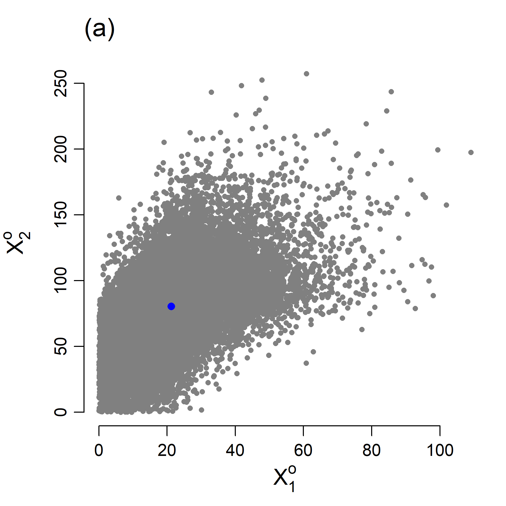
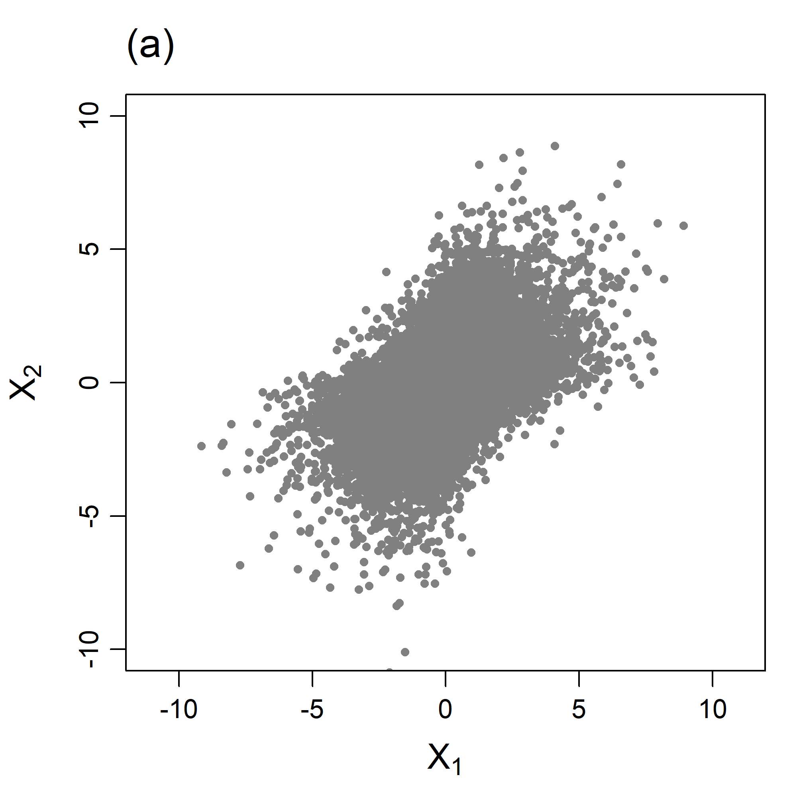
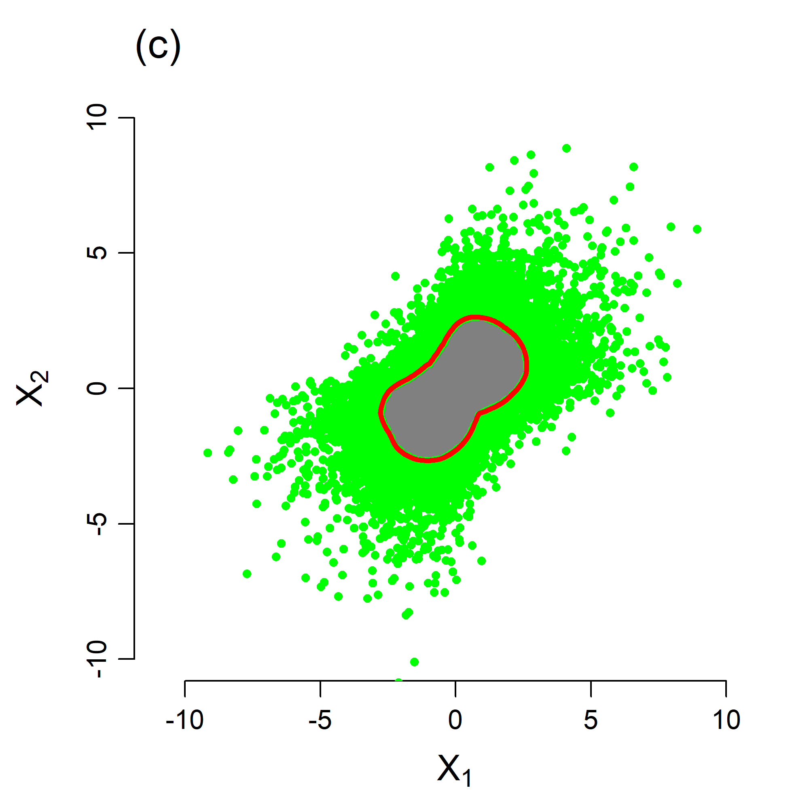
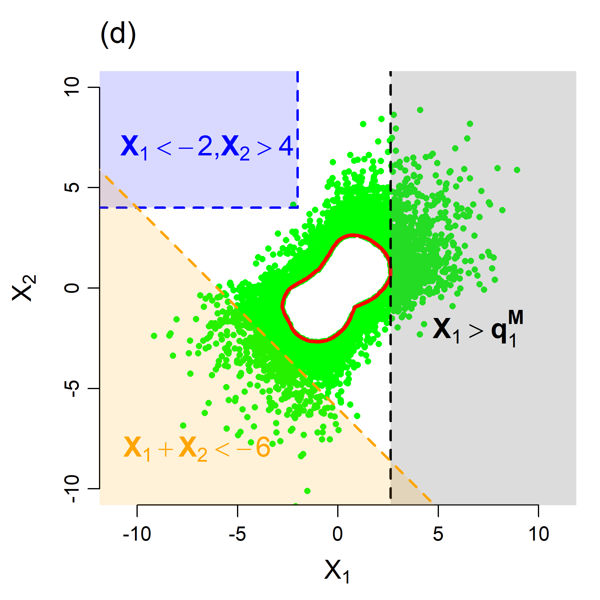

# DeepSPAR-hydroSMILE

**This repository provides the R code accompanying the methodology presented in Murphy-Barltrop et al. (2026). Note this repository adapts and develops the code accompanying Mackay et al. (2025) for fitting the SPAR model (Mackay and Jonathan, 2023) using deep learning techniques.**

In this work, we apply the recently proposed 'Deep SPAR' framework to model concurrent river floods and droughts in four catchments in the Upper Danube basin, based on discharge simulated by a hydrological model driven with large ensemble climate model output (hydroSMILE). Example figures illustrating the SPAR modelling procedure are given below.

  
  
  
  

## Instructions for running the code

The code below can be used to recreate figures from the main article. It can be easily adapted for other datasets and does not require expert AI knowledge to implement. Please follow these steps chronologically. 

### 0. Installing R and RStudio. 

If you have not done so already, please install R and RStudio (in that order) on your workstation. Instructions are given below. 

**Install R**

R is a programming language and must be installed before RStudio.
Go to the CRAN website (https://cran.r-project.org/) and follow the instructions for your operating system.

**Install RStudio**

RStudio is an IDE (Integrated Development Environment) that makes working with R much easier.
Go to the Posit download page (https://posit.co/download/rstudio-desktop), download the free RStudio Desktop version for your operating system, and run the installer.

### 1. Set up a Virtual Envrionment via R in order to run Python with Keras + Tensorflow

This requires one to install several packages in R, then create a virtual environment and install the relevant software. All of the instructions for performing this step are containing in the following script:

**scripts/virtual_env_script.R**

Open this script in RStudio and follow the instructions. Please run through this script prior to attempting to run any of the other scripts. If you encounter any errors, we recommend using an LLM to debug, since minor changes are sometimes required for different operating systems. A Conda environment can also be used in place of a virtual environment, by replacing the relevant `reticulate` code.

After setting up the virtual envrionment, please restart R and RStudio. 

### 2. Pre-processing 

Next, we will pre-process the weekly maxima series to transform them from $\mathbb{R}_+$ to $\mathbb{R}$, and to center the data cloud at $(0,0,0,0)$. The raw weekly maxima series are stored in _data/weekly_maxima/_. All data prodcued by the pre-processing are saved in the folder _data/preprocessed_data/_. The following script carries out the pre-processing:

**scripts/preprocessing.R**

This script also produces plots illustrating the raw and pre-processed datasets; these plots are stored in the _figures/_ folder.

Note that the code in this step, as well as most of the remaining steps, sources the script _scripts/preamble.R_; this script contains a range of functions and packages required for fitting and using our framework.

### 3. Fit the deep SPAR model to data generated from a Gaussian copula. 

To fit the deep SPAR framework and reproduce the illustrative figures provided in the article, please run the following script:

**scripts/paper_figures.R**

This script is very well commented. It describes exactly what each step of the modelling procedure is doing, and the meaning behind lots of the code. To understand the framework, it is recommended to first work through this script line-by-line and gain some intuition as to how, and why, SPAR works. This script also illustrates how we construct our neural networks, and how one can use the Keras package.

All figures generated from this script are again saved in the _figures/_ folder. Neural network model weights are saved in the _nn_parameters/_ folder.

Note that this script provides a basis for understanding the subsequent scripts. As such, the subsequent scripts contain far fewer comments regarding the deep learning model construction. Therefore, please refer to the _scripts/paper_figures.R_ script if anything in the subsequent scripts doesn't make sense. 

### 4. For the deep SPAR model to the discharge data. 

The final step fits our framework to the discharge data simulated via hydroSMILE across every time period. Uncertainty is quantified via bootstrapping. Figures with uncertainty bounds are compiled once all model fitting has been completed. Please run through the next three scripts in the following order:

a) **scripts/discharge_model_fitting.R**
b) **scripts/discharge_uncertainty_assessment.R**
c) **scripts/discharge_diagnostics_and_probabilities.R**

Step a) first fits the model to the four discharge datasets representing each time period. Step b) quantifies the uncertainty across each model fit via bootstrapping. Diagnostic and probability values computed from steps a) and b) are stored in the _computed_model_vals/_ folder, while neural network model weights are saved in the _nn_parameters/_ folder. Finally, step c) produces plots illustrating diagnostics and probability estimates computed from the model fits. As before, all figures generated from this script are saved in the _figures/_ folder.

Note step b) ideally needs to be run on a HPC. However, this is not because of the high computational resources required, but rather the fact it is much quicker when run in parallel, e.g., without a for loop over the bootstrap indices.

And that's it - you're done. You should now have figures illustrating diagnostics and probability estimates across the model fits, alongside a good understanding as to how the model works.

## Descriptions of the provided folders 

Below, we provide brief descriptions of each folder.

**Folders:**

* **computed_model_vals/** - folder where values computed using the fitting deep SPAR models (i.e., diagnostics and probabilities) are stored
* **data/** - folder containing the discharge datasets (original and pre-processed) 
* **figures/** - folder for storing figures 
* **nn_parameters/** - folder for storing neural network model weights
* **scripts** - folder containing all R scripts

## Questions?

Please get in touch if you have any questions, or if you find a bug in the code: callum.murphy-barltrop [at] tu-dresden.de 

### **Happy SPAR-ring!**

### References

Murphy-Barltrop, C. J. R., Richards, J., Poschlod, B., Sasse, A., and Zscheischler, J. (2026). Exploring climate change effects on concurrent floods and concurrent droughts via statistical deep learning. arXiv preprint. 

Mackay, E., & Jonathan, P. (2023). Modelling multivariate extremes through angular-radial decomposition of the density function. arXiv:2310.12711.

Mackay, E., Murphy-Barltrop, C. J. R., Richards, J., and Jonathan, P. (2025). Deep Learning Joint Extremes of Metocean Variables Using the SPAR Model. ASME. J. Offshore Mech. Arct. Eng.; 148(2): 021201.

